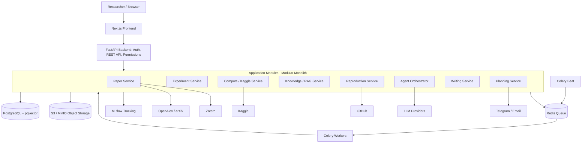
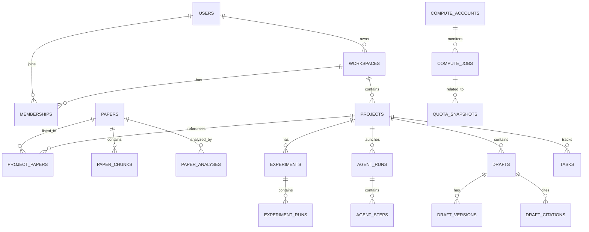
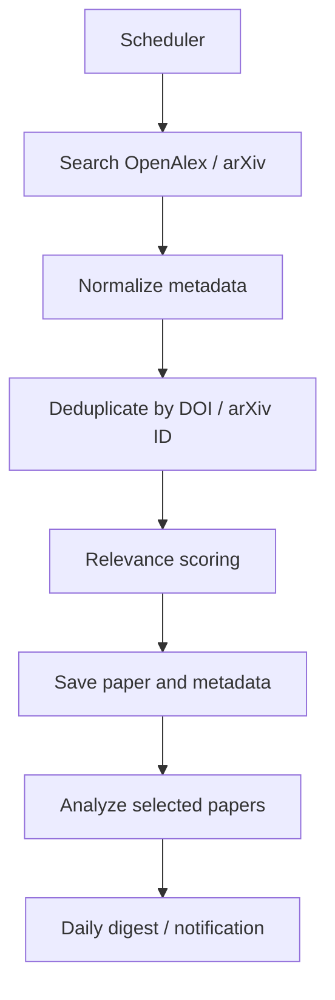
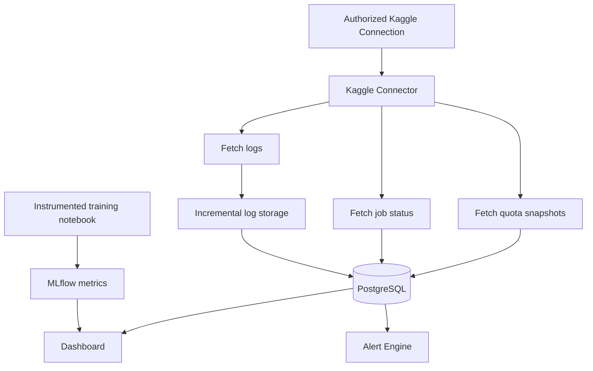
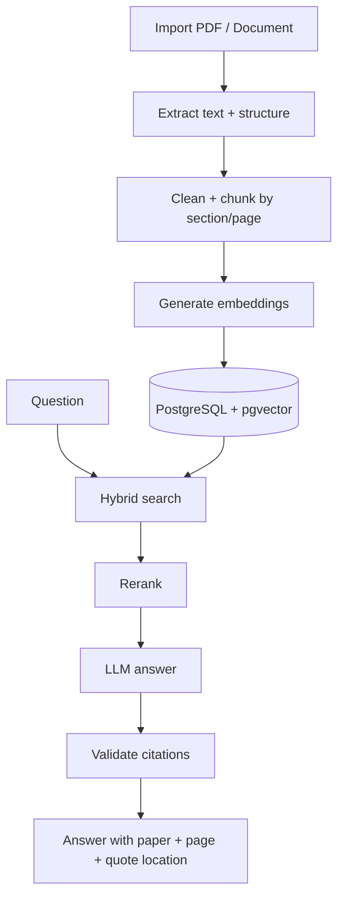
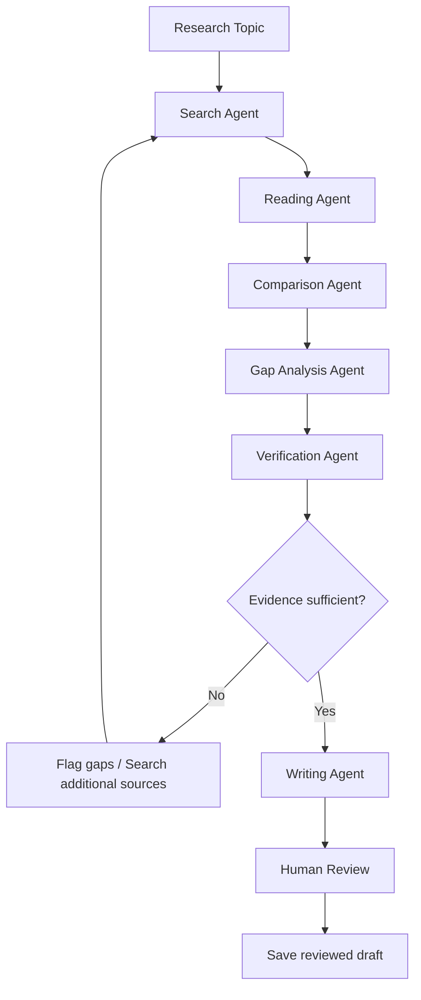
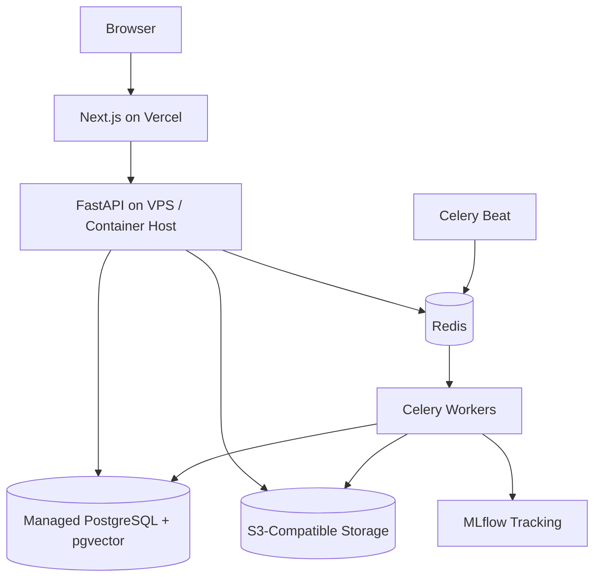
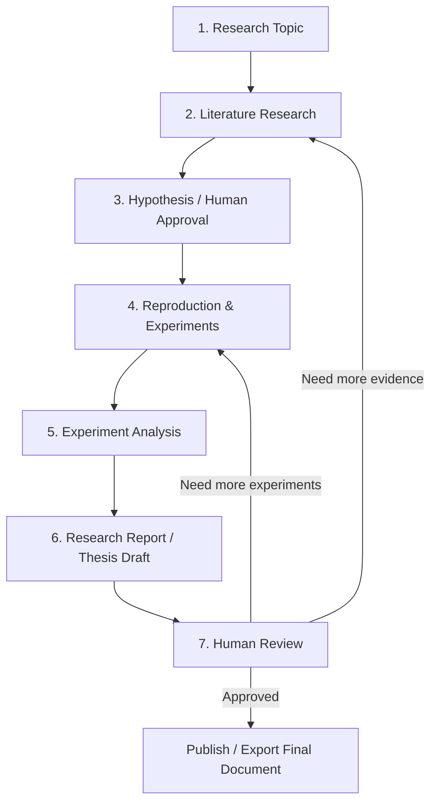

# AI Research OS — Kiến trúc tổng thể & Roadmap phát triển

> **Personal AI Research Operating System**  
> Tài liệu thiết kế dành cho một nền tảng web tự động hóa quy trình nghiên cứu Khoa học máy tính và Trí tuệ nhân tạo (AI).  
> **Phiên bản tài liệu:** 1.0  
> **Ngày biên soạn:** 17/11/2026  
> **Kế hoạch triển khai:** 24 tuần, tham khảo cho một người phát triển bán thời gian khoảng 10–15 giờ/tuần.

---

## Mục lục

1. [Tổng quan và mục tiêu](#1-tổng-quan-và-mục-tiêu)
2. [Danh sách module](#2-danh-sách-module)
3. [Kiến trúc tổng thể](#3-kiến-trúc-tổng-thể)
4. [Technology stack](#4-technology-stack)
5. [Thiết kế database](#5-thiết-kế-database)
6. [Workflow các module](#6-workflow-các-module)
7. [Thiết kế Backend API](#7-thiết-kế-backend-api)
8. [Cấu trúc source code](#8-cấu-trúc-source-code)
9. [Roadmap 24 tuần](#9-roadmap-24-tuần)
10. [Deployment và chi phí](#10-deployment-và-chi-phí)
11. [Bảo mật và độ tin cậy](#11-bảo-mật-và-độ-tin-cậy)
12. [Đánh giá chất lượng AI](#12-đánh-giá-chất-lượng-ai)
13. [Checklist 14 ngày đầu](#13-checklist-14-ngày-đầu)
14. [Workflow nghiên cứu khép kín](#14-workflow-nghiên-cứu-khép-kín)
15. [Các phiên bản sản phẩm](#15-các-phiên-bản-sản-phẩm)
16. [Các dự án thành phần có thể tách riêng](#16-các-dự-án-thành-phần-có-thể-tách-riêng)
17. [Tài liệu kỹ thuật tham khảo](#17-tài-liệu-kỹ-thuật-tham-khảo)

---

## 1. Tổng quan và mục tiêu

### 1.1. Ý tưởng

**AI Research OS** là một nền tảng web cá nhân, có thể mở rộng thành công cụ cho nhóm nghiên cứu, giúp tự động hóa các công việc từ khi bắt đầu tìm ý tưởng đến khi hoàn thành thí nghiệm và viết báo cáo khoa học:

- Tự động tìm kiếm paper từ arXiv, OpenAlex.
- Phân tích, tóm tắt, dịch và so sánh các nghiên cứu.
- Tạo thư viện tri thức hỗ trợ hỏi đáp bằng RAG có trích dẫn nguồn.
- Giám sát notebook, GPU/TPU quota, logs, training metrics trên Kaggle và các môi trường khác.
- Quản lý experiments, checkpoints và khả năng tái hiện kết quả.
- Điều phối các AI Agent tìm kiếm, đọc, so sánh, gợi ý research gaps.
- Hỗ trợ viết đề cương, literature review, thesis với BibTeX/LaTeX.
- Quản lý tiến độ, deadlines, thông báo và báo cáo tự động.
- Theo dõi chi phí LLM, độ tin cậy workflow, mức sử dụng tài nguyên.

### 1.2. Định hướng kiến trúc

| Hạng mục | Định hướng |
|---|---|
| Kiến trúc backend | **Modular Monolith** trong giai đoạn đầu |
| Xử lý bất đồng bộ | **Celery + Redis**, worker độc lập |
| AI | **RAG + workflow-based agents**, bổ sung LangGraph khi cần |
| Database | **PostgreSQL + pgvector** |
| Experiment tracking | **MLflow** |
| File artifacts | Object storage tương thích S3 |
| Giao diện | Next.js + TypeScript + Tailwind |
| Khả năng mở rộng | Module độc lập ở mức code, có thể tách service khi thật sự cần |

**Nguyên tắc sản phẩm:** Chia thành những MVP sử dụng được thật; không xây microservices hoặc một hệ thống multi-agent quá phức tạp ngay từ ngày đầu.

### 1.3. Đối tượng sử dụng

- Bản đầu tiên: cá nhân nghiên cứu AI, học đại học/thạc sĩ.
- Bản nâng cao: nhóm nghiên cứu nhỏ, có workspace, vai trò, thành viên và quyền truy cập.

---

## 2. Danh sách module

| # | Module | Chức năng chính |
|---|---|---|
| 01 | **Paper Discovery & Library** | Tìm paper, lọc chủ đề, lưu PDF, notes, metadata, citations, tóm tắt |
| 02 | **AI Experiment & GPU Manager** | Theo dõi Kaggle, compute quota, job status, logs, metrics, checkpoints, so sánh runs |
| 03 | **Research Knowledge Base** | Kho tri thức từ paper, tài liệu, notes, thí nghiệm; tìm kiếm RAG có dẫn nguồn |
| 04 | **Multi-Agent Research Assistant** | Search/Reading/Comparison/Gap Analysis/Verification/Writing Agents |
| 05 | **Paper Reproduction** | Phân tích repository, thiết lập môi trường, tái hiện benchmark có kiểm soát |
| 06 | **Thesis & Academic Writing** | Bản nháp, versions, BibTeX, LaTeX, bảng, biểu đồ, citations |
| 07 | **Research Planning & Automation** | Tasks, milestones, deadlines, báo cáo tuần, lịch tự động |
| 08 | **System Monitoring & AI Cost** | Quản lý token usage, chi phí API, lỗi workflow, audit logs, chất lượng |

Tất cả các module chia sẻ các thành phần **Users, Workspaces, Projects, Permissions, Notifications, Storage, Background Jobs**.

### 2.1. Ví dụ trải nghiệm sử dụng

- Tạo project **Image-Text Retrieval**.
- Chọn nhóm từ khóa **Contrastive Learning**, **Vision-Language Model**, **Hard Negative Mining**.
- Hệ thống tự tìm paper mới, lọc trùng, lưu và tóm tắt.
- Chat RAG để so sánh các phương pháp, có trích dẫn tới đoạn văn và trang PDF.
- Chọn baseline để tái hiện, liên kết repository và cấu hình huấn luyện.
- Chạy mô hình trên tài nguyên hợp lệ (ví dụ notebook Kaggle), theo dõi logs và lưu metrics vào MLflow.
- Tạo bảng so sánh kết quả, draft literature review và báo cáo tiến độ.

---

## 3. Kiến trúc tổng thể

### 3.1. Sơ đồ thành phần



> Đây là sơ đồ logic. Khi triển khai, worker sử dụng các service/domain functions phù hợp, không nhất thiết gọi HTTP vòng qua API. Phân quyền và kiểm soát truy cập phải được thực thi thống nhất tại mọi entry point.

### 3.2. Vai trò từng tầng

| Tầng | Nhiệm vụ |
|---|---|
| Frontend | Dashboard, library, experiments, agent runs, writing, planning |
| FastAPI | Authentication, REST API, authorization, input validation |
| Application modules | Business logic độc lập theo từng miền nghiệp vụ |
| Celery Workers | Xử lý PDF, embedding, đồng bộ compute, LLM jobs, reports |
| Celery Beat | Lịch chạy định kỳ: sync quota, discovery paper, báo cáo tuần |
| LangGraph | Điều phối AI Agent có checkpoint và human-in-the-loop |
| PostgreSQL | Dữ liệu chính, trạng thái workflow, job, relations |
| pgvector | Lưu vector và tìm kiếm ngữ nghĩa |
| Object Storage | PDF, exports, artifacts, files, logs lớn |
| MLflow | Parameters, metrics, runs, experiment artifacts |
| Integrations | Kaggle, arXiv, OpenAlex, Zotero, GitHub, LLM, Telegram |

### 3.3. Lý do chọn Modular Monolith

- Ít chi phí vận hành hơn nhiều microservices.
- Dễ debug, thiết lập local environment và migrations.
- Giữ được các ranh giới rõ ràng: `papers`, `experiments`, `agents`, `compute`...
- Worker độc lập giải quyết được phần lớn nhu cầu chạy việc nặng.
- Chỉ tách service khi module có đặc điểm scaling hoặc isolation rất khác biệt.

---

## 4. Technology stack

| Lĩnh vực | Công nghệ đề xuất | Mục đích |
|---|---|---|
| Frontend | Next.js, TypeScript | Web dashboard |
| UI | Tailwind CSS, shadcn/ui | Thành phần UI nhất quán |
| Charts | Recharts hoặc Plotly | Biểu đồ metrics và quota |
| Backend | Python, FastAPI | API + xử lý AI |
| ORM/Migrations | SQLAlchemy, Alembic | Schema và migration |
| Data | PostgreSQL | Database chính |
| Vector Search | pgvector | Embeddings và similarity search |
| Queue / Jobs | Redis, Celery, Celery Beat | Jobs và lịch định kỳ |
| AI Agent | LangGraph | Multi-step orchestration, checkpoints |
| LLM | Provider abstraction | Đổi model dễ, quản lý chi phí |
| PDF | PyMuPDF + parser cấu trúc | Trích xuất nội dung và trang |
| MLOps | MLflow | Experiment tracking |
| Artifacts | MinIO / S3-compatible storage | PDFs, checkpoints, exports |
| Authentication | OIDC/OAuth + session | Không tự viết xử lý mật khẩu nếu không cần |
| Local/Deploy | Docker Compose | Chạy cùng môi trường dev/prod |
| Tests | Pytest, Playwright | Backend và E2E |
| CI/CD | GitHub Actions | Test tự động, build, deploy |
| Observability | Structured logs, metrics, traces | Điều tra lỗi và usage |

**Lưu ý:** Có thể khởi đầu bằng OpenAI API hoặc một provider khác; thiết kế interface `LLMProvider` để tránh khóa cứng toàn bộ ứng dụng vào một model.

---

## 5. Thiết kế database

### 5.1. Các nhóm bảng

| Nhóm | Bảng | Lưu gì? |
|---|---|---|
| Core | `users`, `workspaces`, `memberships`, `projects` | Tài khoản, nhóm, vai trò, dự án |
| Papers | `papers`, `project_papers`, `paper_files`, `paper_chunks`, `paper_notes` | Metadata, PDFs, chunks, notes |
| Research | `research_topics`, `paper_analyses`, `literature_reviews` | Chủ đề, phân tích, báo cáo |
| Experiments | `experiments`, `experiment_runs`, `run_artifacts` | Training run, params, artifacts |
| Compute | `compute_accounts`, `compute_jobs`, `quota_snapshots`, `job_logs` | Compute connectors, quota, status, logs |
| Knowledge | `document_chunks`, `retrieval_feedback` | Chunks, embeddings, phản hồi |
| Agents | `agent_runs`, `agent_steps`, `tool_calls` | Agent workflow, bước xử lý |
| Writing | `drafts`, `draft_versions`, `draft_citations` | Bản nháp, versions, citations |
| Planning | `tasks`, `milestones`, `scheduled_workflows` | Công việc, lịch, cột mốc |
| System | `notifications`, `usage_records`, `audit_logs` | Thông báo, costs, audit |

### 5.2. Sơ đồ quan hệ rút gọn



> Sơ đồ là định hướng và sẽ được chuẩn hóa khi viết migrations. Ví dụ thực tế: `quota_snapshots` thường tham chiếu `compute_accounts`, còn `compute_jobs` tham chiếu account; không nhất thiết gắn snapshot trực tiếp với từng job.

### 5.3. Trường dữ liệu quan trọng

**Bảng `papers`:**
- `id`, `title`, `abstract`, `doi`, `arxiv_id`, `publication_date`, `source_url`, `license`, `created_at`, `updated_at`.
- Chuẩn hóa metadata tác giả; ưu tiên ràng buộc unique cho DOI hoặc arXiv ID khi có.

**Bảng `paper_chunks`:**
- `id`, `paper_id`, `file_id`, `page_number`, `section`, `chunk_index`, `text`, `embedding`, `embedding_model_version`, `text_offsets`.
- Có thể chứa `content_hash` để tái sử dụng embedding.

**Bảng `experiment_runs`:**
- `id`, `experiment_id`, `compute_job_id`, `mlflow_run_id`, `status`, `started_at`, `ended_at`, `parameters`, `summary_metrics`, `artifact_uri`, `git_commit`.

**Bảng `compute_accounts`:**
- `id`, `workspace_id`, `provider`, `account_label`, `credential_reference`, `enabled`, `last_sync_at`.
- **Không lưu API key thô** trong bảng hoặc trả về client.

**Bảng `agent_runs`:**
- `id`, `project_id`, `workflow_type`, `status`, `input_payload`, `output_artifact_id`, `token_usage`, `estimated_cost`, `started_at`, `finished_at`, `error_summary`.

**Bảng `draft_citations`:**
- `id`, `draft_id`, `paper_id`, `chunk_id`, `citation_key`, `claim_span`, `verification_status`.

### 5.4. Nguyên tắc dữ liệu

1. Mọi truy vấn dữ liệu riêng tư phải kiểm tra `workspace_id` và phân quyền.
2. Dùng bảng trung gian cho quan hệ many-to-many như `project_papers`.
3. Tạo index theo khóa ngoại, thời gian, trạng thái, DOI/arXiv ID và workload truy vấn thực tế.
4. Đặt phiên bản cho schema, embeddings, prompts và mô hình phân tích.
5. Lưu references đến object storage thay vì đưa PDF hoặc log lớn vào database.
6. Lưu audit logs cho thao tác nhạy cảm và thay đổi credentials.

---

## 6. Workflow các module

### 6.1. Paper Discovery & Library

**Mục tiêu:** Tự động cập nhật tài liệu phù hợp với chủ đề nghiên cứu.



Các bước:
1. Người dùng cấu hình chủ đề và từ khóa.
2. Celery Beat kích hoạt theo lịch.
3. Adapter OpenAlex/arXiv trả về metadata và các link truy cập hợp lệ.
4. Dedupe theo DOI, arXiv ID hoặc metadata khi thiếu định danh.
5. Xếp hạng mức phù hợp theo từ khóa, semantic score và preferences.
6. Chỉ gọi LLM cho tập paper liên quan nhất để giảm chi phí.
7. Lưu vào library, gửi digest và tùy chọn đồng bộ Zotero.

Ví dụ cấu hình:

```yaml
research_topic: "Image-Text Retrieval"
keywords:
  - "Contrastive Learning"
  - "Vision-Language Model"
  - "Hard Negative Mining"
sources:
  - openalex
  - arxiv
schedule: "0 8 * * *"
timezone: "Asia/Ho_Chi_Minh"
max_papers_per_day: 20
max_ai_analyses_per_day: 5
```

Các trang paper cần có: tiêu đề, abstract, authors, DOI, năm, link gốc, dataset/method/metrics nếu đã phân tích, notes, tags, trạng thái đã đọc, liên kết với projects.

### 6.2. Kaggle & Experiment Monitoring

**Mục tiêu:** Theo dõi notebook/job, quota, logs và training results mà không phải kiểm tra thủ công liên tục.



| Chức năng | Triển khai |
|---|---|
| Quota | Lấy snapshot quota hợp lệ từ CLI/API, cập nhật định kỳ |
| Job status | Polling có backoff theo trạng thái; tránh request quá mức |
| Logs | Lưu log mới, chống duplicate, hỗ trợ pagination/tail |
| Epoch metrics | Instrument training code ghi loss/accuracy/F1 vào MLflow |
| Checkpoints | Lưu metadata + URI đến storage hoặc output notebook |
| Alerts | Trạng thái thành công/thất bại, vượt ngưỡng, lỗi sync |
| Compare runs | Đọc MLflow metrics, params và best checkpoints |

Các lệnh Kaggle CLI tham khảo, cần kiểm tra lại bằng `kaggle --help` trên phiên bản đã cài:

```bash
kaggle quota --format json
kaggle kernels status owner/notebook-name
kaggle kernels logs owner/notebook-name
```

Ví dụ instrument MLflow:

```python
import mlflow

mlflow.set_tracking_uri("https://mlflow.your-domain.com")
mlflow.set_experiment("image-text-retrieval")

with mlflow.start_run():
    mlflow.log_param("batch_size", 64)
    mlflow.log_param("learning_rate", 1e-4)

    for epoch in range(epochs):  # epochs và các hàm bên dưới do ứng dụng cung cấp
        train_loss = train_one_epoch(...)
        val_score = validate(...)
        mlflow.log_metric("train_loss", train_loss, step=epoch)
        mlflow.log_metric("val_score", val_score, step=epoch)
```

**Giới hạn quan trọng:**
- Status/logs của Kaggle không tự bảo đảm có metrics theo từng epoch; cần tự ghi metrics.
- Notebook chỉ có thể gửi metrics trực tiếp nếu kết nối đến tracking server được phép và bảo mật tốt.
- Phương án dự phòng: xuất metrics JSON/CSV từ job rồi đồng bộ khi hoàn thành.
- Chỉ kết nối tài khoản được chủ sở hữu cho phép; không thiết kế hệ thống để vượt quota, luân chuyển tài khoản né giới hạn hoặc vi phạm điều khoản dịch vụ.

### 6.3. Research Knowledge Base — RAG

**Mục tiêu:** Cho phép hỏi đáp trên paper, PDF, notes và kết quả thực nghiệm, đi kèm nguồn chứng minh.



**Yêu cầu trọng tâm: Citation-aware RAG**
- Mỗi chunk gắn với document ID, page, section và offsets.
- Trích dẫn phải chỉ về tài liệu tồn tại, nội dung thực có trong nguồn.
- Không đủ bằng chứng thì trả lời chưa đủ căn cứ.
- Dùng hybrid search (full-text + vectors) và reranker khi cần.
- Đánh giá retrieval chất lượng bằng bộ câu hỏi có ground truth.

### 6.4. Multi-Agent Research Assistant

| Agent | Nhiệm vụ | Đầu ra |
|---|---|---|
| Search Agent | Tìm nguồn liên quan | Paper IDs, metadata |
| Reading Agent | Trích xuất problem/method/dataset/metrics/limitations | Structured JSON |
| Comparison Agent | So sánh phương pháp, benchmark | Comparison matrix |
| Gap Analysis Agent | Đề xuất khoảng trống nghiên cứu cần kiểm chứng | Research-gap candidates |
| Experiment Analysis Agent | Phân tích metrics, logs từ MLflow | Experiment report |
| Verification Agent | Kiểm tra trích dẫn và claim | Verification report |
| Writing Agent | Dựng bản nháp tổng quan nghiên cứu | Markdown/LaTeX |



**Ví dụ structured output từ Reading Agent:**

```json
{
  "paper_id": "paper_uuid",
  "research_problem": "...",
  "proposed_method": "...",
  "datasets": [],
  "metrics": [],
  "limitations": [],
  "evidence": [
    { "chunk_id": "chunk_uuid", "page": 5 }
  ]
}
```

**Quy tắc vận hành agents:**
- Dữ liệu trao đổi có schema và được validate.
- Có giới hạn số lần lặp, độ dài thời gian và token budget.
- Lưu tool calls, input/output, version prompt/model và trace.
- Human approval với hành động có rủi ro: chạy mã repo ngoài, khởi tạo GPU job, xóa dữ liệu, gửi tài liệu.
- Gap Analysis chỉ tạo **ứng viên giả thuyết**, không tuyên bố chắc chắn là chưa ai nghiên cứu.
- Đọc PDF/web như dữ liệu không tin cậy; không làm theo chỉ dẫn có trong tài liệu thay cho yêu cầu hợp lệ của người dùng.

### 6.5. Paper Reproduction & Benchmark

Các bước của một reproduction workflow:
1. Chọn paper và repository (nếu được công bố).
2. Lưu repository URL, Git commit hash, license, dependency info.
3. Phân tích README/requirements, phiên bản Python/CUDA, dataset và preprocessing.
4. Đề xuất environment manifest và experiment configuration.
5. Người dùng duyệt nơi chạy, cấu hình, chi phí.
6. Thực thi trong sandbox/container giới hạn quyền và mạng.
7. Lưu logs, seed, hardware, package versions, artifact refs.
8. So sánh metrics tái hiện với số liệu từ paper gốc.
9. Xuất báo cáo kết quả và nguyên nhân chênh lệch.

**Reproduction record cần có:** Paper ID, repo/commit, Python/CUDA packages, dataset/license/checksum, preprocessing, hyperparameters, seed, device, published metrics, reproduced metrics, logs, kết luận.

**Bảo mật:** Không chạy repository bên ngoài trong môi trường chứa API keys hoặc dữ liệu nhạy cảm. Dùng container cô lập, không truyền secrets mặc định, giới hạn quyền và egress.

### 6.6. Thesis & Academic Writing

Workflow:
1. Chọn section (ví dụ: Related Work).
2. Tìm bằng chứng trong Knowledge Base.
3. Tạo outline và bản nháp.
4. Kiểm tra citations đến paper/chunk.
5. Người dùng sửa, duyệt, quản lý versions.
6. Xuất Markdown/LaTeX/BibTeX, tạo bảng/biểu đồ từ experiments.

Tính năng cần có:
- Tạo thesis/project outline.
- Draft editor với version history.
- Quản lý bibliography, liên kết Zotero.
- Tạo bảng experiment comparison từ dữ liệu thực.
- Export và kiểm tra citations; không tạo trích dẫn không tồn tại.

### 6.7. Research Planning & Automation

- Project Kanban: todo, in progress, blocked, done.
- Milestones liên kết trực tiếp papers, runs, drafts.
- Lịch nghiên cứu/đề cương/meeting/deadline.
- Báo cáo tiến độ tuần dựa vào hoạt động đã ghi nhận.
- Thông báo về các job hoàn thành, workflow lỗi, deadline sắp tới.
- Cho phép tắt/bật scheduled workflows, tránh chạy ngoài ý muốn.

### 6.8. System Monitoring & AI Cost

- Lưu LLM provider, model, prompt version, tokens, estimated cost.
- Lưu số lượng tool calls, latency, retries, failed jobs.
- Dashboard API budget theo project và workflow.
- Quota alert, budget cap, max token/request, retention policy.
- Audit logs cho thay đổi quyền, kết nối tài khoản, xóa tài liệu.

---

## 7. Thiết kế Backend API

**API prefix:** `/api/v1`.

| Nhóm | Endpoints ví dụ |
|---|---|
| Projects | `GET /projects`, `POST /projects`, `GET /projects/{id}` |
| Papers | `GET /papers`, `POST /papers/import`, `GET /papers/{id}` |
| Discovery | `POST /discovery/jobs`, `GET /discovery/jobs/{id}` |
| Knowledge | `POST /knowledge/ask`, `POST /knowledge/documents` |
| Experiments | `GET /experiments`, `GET /runs/{id}`, `GET /runs/{id}/metrics` |
| Compute | `POST /connections/kaggle`, `GET /compute/jobs`, `GET /compute/quotas` |
| Agents | `POST /agent-runs`, `GET /agent-runs/{id}` |
| Writing | `POST /drafts`, `POST /drafts/{id}/export` |
| Planning | `GET /tasks`, `POST /tasks`, `GET /milestones` |
| Monitoring | `GET /system/usage`, `GET /system/jobs` |

### 7.1. Tác vụ bất đồng bộ

Tác vụ dài nên trả về `202 Accepted` cùng `job_id`, ví dụ:

```json
{
  "job_id": "job_uuid",
  "status": "queued",
  "status_url": "/api/v1/jobs/job_uuid"
}
```

Frontend cập nhật qua `GET /api/v1/jobs/{id}` hoặc Server-Sent Events (SSE). Trạng thái chung: `queued`, `running`, `completed`, `failed`, `cancelled`.

### 7.2. Các quy ước API

- Xác thực tất cả API riêng tư.
- Authorize theo workspace và object ownership, không chỉ theo URL.
- Phân trang cho papers/logs/jobs.
- Version API, input validation, standardized error response.
- Rate limiting và request timeouts.
- Idempotency key cho các tác vụ có nguy cơ tạo trùng.
- Ghi trace ID để debug từ frontend tới worker.

---

## 8. Cấu trúc source code

```text
ai-research-os/
├── apps/
│   ├── web/                     # Next.js
│   │   ├── app/
│   │   ├── components/
│   │   ├── features/
│   │   └── lib/
│   └── api/                     # FastAPI
│       ├── app/
│       │   ├── core/            # Auth, config, security
│       │   ├── db/              # Models, migrations
│       │   ├── modules/
│       │   │   ├── papers/
│       │   │   ├── experiments/
│       │   │   ├── compute/
│       │   │   ├── knowledge/
│       │   │   ├── agents/
│       │   │   ├── reproduction/
│       │   │   ├── writing/
│       │   │   └── planning/
│       │   └── integrations/
│       │       ├── kaggle/
│       │       ├── openalex/
│       │       ├── arxiv/
│       │       ├── zotero/
│       │       ├── mlflow/
│       │       └── llm/
│       └── tests/
├── workers/
│   ├── celery_app.py
│   ├── scheduled_tasks/
│   └── workflows/
├── packages/
│   └── shared-types/
├── infrastructure/
│   ├── docker/
│   └── monitoring/
├── docs/
│   ├── adr/
│   ├── architecture/
│   ├── api/
│   └── evaluation/
├── .github/workflows/
├── compose.yaml
└── README.md
```

Trong `docs/adr/`, ghi **Architecture Decision Records**: tại sao chọn Celery thay vì một công cụ khác, vì sao dùng pgvector, khi nào tách service, lý do dùng API model/provider nào.

---

## 9. Roadmap 24 tuần

> Kế hoạch dự kiến cho người phát triển bán thời gian; có thể nới rộng nếu việc học, ngân sách hoặc nghiên cứu thực tế thay đổi. Các mốc **Definition of Done** quan trọng hơn deadline cứng.

### Tổng hợp tiến độ

| Giai đoạn | Tuần | Phạm vi | Deliverable |
|---|---|---|---|
| 1 | 1–2 | Foundation | Dashboard + Auth + Projects |
| 2 | 3–6 | Kaggle & MLOps | **MVP 1:** Quota, status, logs, MLflow |
| 3 | 7–10 | Paper Library | Discovery + PDF + notes |
| 4 | 11–13 | RAG | **MVP 2:** Knowledge Base có citations |
| 5 | 14–16 | Research Agents | Literature Review workflows |
| 6 | 17–19 | Paper Reproduction | Reproduction workflow an toàn |
| 7 | 20–22 | Thesis & Planning | Writing + citations + milestones |
| 8 | 23–24 | Testing & Release | **v1.0:** Production ổn định |

### Giai đoạn 1 — Foundation (Tuần 1–2)

**Mục tiêu:** Có web backend/frontend hoạt động, lưu dữ liệu, quản lý account và project.

| Tuần | Việc cần làm |
|---|---|
| **1** | GitHub repository, Next.js, FastAPI, Docker Compose, PostgreSQL, Redis |
| **2** | Auth, project CRUD, database migrations, dashboard layout, CI tests |

**Definition of Done:** Có thể đăng nhập, tạo/sửa project; database lưu bền vững; frontend gọi backend thành công; migrations và tests chạy được.

### Giai đoạn 2 — Kaggle & MLOps (Tuần 3–6)

**Mục tiêu:** Có ứng dụng hữu ích ngay để theo dõi AI training.

| Tuần | Việc cần làm |
|---|---|
| **3** | Kaggle Connector; auth/credentials; lấy quota |
| **4** | Đồng bộ notebook status và logs; logs viewer |
| **5** | Tích hợp MLflow; experiments, runs và metrics |
| **6** | Dashboard charts, alerts Telegram, so sánh runs |

**Definition of Done:** Theo dõi được một notebook thật, nhận trạng thái hoàn thành/lỗi, xem logs, so sánh ít nhất 2 runs.

**Sản phẩm:** **MVP 1.0 – Experiment Tracker**.

### Giai đoạn 3 — Paper Library (Tuần 7–10)

| Tuần | Việc cần làm |
|---|---|
| **7** | Papers schema, PDF upload, metadata parser |
| **8** | Tích hợp OpenAlex và arXiv |
| **9** | Search/filter/tags/bookmarks/collections |
| **10** | Scheduled discovery, summaries, notifications |

**Definition of Done:** Tạo topic → tìm paper mới → dedupe → lọc → lưu và xem trong library.

### Giai đoạn 4 — RAG Knowledge Base (Tuần 11–13)

| Tuần | Việc cần làm |
|---|---|
| **11** | PDF extraction, chunking, embeddings, pgvector |
| **12** | Hybrid search, rerank, hỏi đáp RAG |
| **13** | Citation validation, retrieval evaluations, hallucination tests |

**Definition of Done:** Hỏi đáp dựa trên nhiều paper; mỗi ý quan trọng có thể dẫn về đúng paper và trang nguồn.

**Sản phẩm:** **MVP 2.0 – AI Research Library**.

### Giai đoạn 5 — Multi-Agent Research (Tuần 14–16)

| Tuần | Việc cần làm |
|---|---|
| **14** | Search Agent, Reading Agent, structured JSON |
| **15** | Comparison Agent, Gap Analysis Agent |
| **16** | LangGraph orchestration, checkpoints, human approval, literature report |

**Definition of Done:** Từ một research topic có thể tạo comparison matrix và bản nháp review với evidence links để người dùng duyệt.

### Giai đoạn 6 — Paper Reproduction (Tuần 17–19)

| Tuần | Việc cần làm |
|---|---|
| **17** | GitHub metadata, requirements/dependency analysis |
| **18** | Sandbox, experiment configuration, safe execution |
| **19** | MLflow results, benchmark comparison, report |

**Definition of Done:** Tái hiện được một baseline đơn giản trong sandbox, lưu đầy đủ cấu hình và kết quả.

### Giai đoạn 7 — Thesis & Planning (Tuần 20–22)

| Tuần | Việc cần làm |
|---|---|
| **20** | Zotero, BibTeX, Writing Workspace |
| **21** | Markdown/LaTeX export, versioning, citation verification |
| **22** | Kanban, milestones, weekly research report |

**Definition of Done:** Có thể tạo bản nháp dẫn nguồn hợp lệ và theo dõi tiến độ cùng dữ liệu experiment.

### Giai đoạn 8 — Hardening & Deployment (Tuần 23–24)

**Việc cần làm:**
- E2E tests, API tests, load and resilience checks.
- Permission tests, rate limiting, credential handling, prompt injection checks.
- Backup + restore test.
- Monitoring, alerting, structured logs, operational dashboard.
- CI/CD and cloud deployment.

**Definition of Done:** Có production URL, dịch vụ tự khởi động lại, workflows có retry, dữ liệu phục hồi được từ backup đã kiểm thử.

---

## 10. Deployment và chi phí

### 10.1. Môi trường development

Windows + WSL2 + Docker Desktop (hoặc Linux/macOS) chạy Docker Compose:

- Next.js
- FastAPI
- PostgreSQL + pgvector
- Redis
- Celery Worker + Celery Beat
- MinIO
- MLflow

### 10.2. Kiến trúc production



> Không dùng frontend serverless functions cho các công việc chạy lâu: xử lý PDF lớn, workflow agent dài, compute orchestration. Dùng worker độc lập và persistent state.

### 10.3. Chi phí cần kiểm soát

Nguồn chi phí:
- LLM API tokens và embeddings.
- Database, storage, backup, network traffic.
- VPS/worker, logs và monitoring.
- GPU compute nếu có sử dụng tài nguyên trả phí.

Biện pháp:
- Cache kết quả phân tích theo content hash + model/prompt version.
- Chỉ phân tích các paper liên quan nhất.
- Token budgets và max iterations cho agent runs.
- Lưu usage/cost cho từng project.
- Phân tầng storage và retention cho logs/artifacts lớn.
- Giai đoạn đầu không cần mua GPU server riêng chỉ để vận hành Research OS.

---

## 11. Bảo mật và độ tin cậy

| Rủi ro | Giải pháp |
|---|---|
| Lộ API/Kaggle tokens | Lưu credential server-side đã mã hóa, secret manager nếu có; không trả secrets về frontend |
| Truy cập nhầm workspace | Authorization ở mọi API/job, ownership checks |
| Job bị lỗi hoặc timeout | Retry có giới hạn, exponential backoff, idempotent tasks, checkpoints |
| LLM hallucination | Citation/claim validation và không trả lời quá bằng chứng |
| Prompt injection từ paper/web | Nội dung tài liệu là untrusted data; hạn chế tool permissions |
| Mã nguồn bên ngoài độc hại | Sandbox/container cô lập, giới hạn network/file system, không cấp mặc định secrets |
| Agent chạy vòng lặp, quá budget | Max steps, max tokens, timeout, approval gates |
| Data loss | Backup định kỳ + thử restore |
| Xâm phạm quyền tác giả | Tuân thủ điều kiện truy cập, giấy phép, lưu nguồn và không phân phối PDF trái phép |
| Vượt giới hạn dịch vụ | Tuân thủ API rate limits, terms và account permissions |

**Đối với tài khoản Kaggle:** Chỉ kết nối tài khoản do chính mình sở hữu hoặc được chủ tài khoản cho phép. Không dùng tự động hóa để vượt quota tài nguyên hay quy định nền tảng.

---

## 12. Đánh giá chất lượng AI

| Module | Chỉ số đánh giá |
|---|---|
| Paper Discovery | Precision@10, paper duplication rate, relevance feedback |
| RAG Retrieval | Recall@5/10, MRR hoặc nDCG |
| RAG Answer | Citation correctness, unsupported-claim rate, factuality |
| Literature Review | Coverage, evidence sufficiency, human review score |
| Experiment Monitor | Sync success rate, status latency, alert precision |
| Agent Workflows | Success rate, latency, token cost, retry rate |
| System | Uptime, API error rate, successful restore tests |

**Bài kiểm thử đề xuất:** Xây bộ 30–50 câu hỏi có expected answer và page/chunk evidence đã được con người xác nhận. Chạy đánh giá lại khi thay chunking, embedding, reranker, LLM hoặc prompts.

---

## 13. Checklist 14 ngày đầu

> Có thể tích ngay trong VS Code hoặc GitHub Issues.

- [ ] **Ngày 1–2:** Tạo monorepo, Next.js, FastAPI, Docker Compose.
- [ ] **Ngày 3:** Thiết lập PostgreSQL, Redis và migrations.
- [ ] **Ngày 4–5:** Tạo auth, workspaces, projects models.
- [ ] **Ngày 6–7:** Xây dashboard, sidebar và project CRUD.
- [ ] **Ngày 8–9:** Tạo Kaggle Connector và validate credentials.
- [ ] **Ngày 10:** Viết API lấy quota và notebook status.
- [ ] **Ngày 11:** Tạo compute jobs và quota snapshots schema.
- [ ] **Ngày 12:** Viết Celery task đồng bộ Kaggle.
- [ ] **Ngày 13:** Hiển thị notebook list, status và logs.
- [ ] **Ngày 14:** Tests, error handling và demo end-to-end.

**Output sau 14 ngày:** Đăng nhập → tạo project → kết nối Kaggle được phép → xem quota/job status/logs trong một dashboard đơn giản.

---

## 14. Workflow nghiên cứu khép kín



**Vai trò con người:** Quyết định giả thuyết, phương pháp, kiểm tra luận cứ, đánh giá kết quả khoa học, phê duyệt tài liệu. AI hỗ trợ tìm kiếm, tổ chức, theo dõi và phân tích — không thay thế trách nhiệm học thuật của người nghiên cứu.

---

## 15. Các phiên bản sản phẩm

### MVP 1 — Research & Experiment Tracker

**Ưu tiên phát triển đầu tiên.**
- Quản lý projects.
- Kaggle notebook status, logs, quota.
- MLflow experiment tracking, comparison chart.
- Cảnh báo khi jobs hoàn tất hoặc thất bại.

### MVP 2 — AI Research Library

- Paper discovery, metadata và PDF library.
- Semantic search, RAG, citations.
- Notes, reading status, collection và Zotero integration (có thể bổ sung sau).

### Version 1.0 — Research Automation Platform

- Multi-Agent Literature Review.
- Paper reproduction workflow.
- Thesis/academic writing, citation checks.
- Planning, scheduling, operational dashboard, budgets và observability.

### Mở rộng tương lai

- Team workspaces, role-based permissions.
- Reproducibility scorecards, dataset registry.
- More GPU providers và compute connectors.
- Research graph, citation graph, team collaboration.
- Local-model support, offline reading, advanced eval dashboards.

---

## 16. Các dự án thành phần có thể tách riêng

Nếu không muốn làm ngay toàn bộ OS, đây là sáu sản phẩm độc lập để phát triển:

| Dự án | Tự động hóa | Độ khó tương đối |
|---|---|---|
| AI Paper Research Assistant | Tìm/tóm tắt/dịch/so sánh paper | Trung bình |
| AI Experiment Manager | Kaggle/GPU, logs, checkpoints, metrics | Trung bình |
| AI Literature Review Agent | Tổng hợp công trình và đề xuất research gaps | Khó |
| Research Reproduction Agent | Tìm code, môi trường, tái hiện benchmark | Rất khó |
| AI Thesis Writing Assistant | Citations, bản nháp, bảng biểu | Trung bình |
| Research Planning Agent | Tasks, milestones, deadlines, reminders | Dễ |

**Khuyến nghị:** Bắt đầu bằng **Experiment Dashboard**, sau đó mở rộng thành **Paper Library + RAG**, cuối cùng xây **Multi-Agent Research Workflows**. Cách này giúp dự án tạo giá trị thực tế từng bước và vẫn có cơ hội trở thành portfolio về AI Engineering, Agentic AI, RAG, MLOps và Software Architecture.

---

## 17. Tài liệu kỹ thuật tham khảo

Các nguồn chính thức hữu ích khi triển khai; cần đối chiếu phiên bản API/tài liệu tại thời điểm code:

- [FastAPI Documentation](https://fastapi.tiangolo.com/)
- [Next.js Documentation](https://nextjs.org/docs)
- [PostgreSQL Documentation](https://www.postgresql.org/docs/)
- [pgvector — GitHub](https://github.com/pgvector/pgvector)
- [Celery Documentation](https://docs.celeryq.dev/)
- [LangGraph Documentation](https://docs.langchain.com/oss/python/langgraph/overview)
- [MLflow Documentation](https://mlflow.org/docs/latest/index.html)
- [OpenAlex API](https://docs.openalex.org/)
- [arXiv API](https://info.arxiv.org/help/api/index.html)
- [Zotero Web API](https://www.zotero.org/support/dev/web_api/v3/start)
- [Kaggle CLI](https://github.com/Kaggle/kaggle-api)
- [Docker Compose](https://docs.docker.com/compose/)
- [PyMuPDF Documentation](https://pymupdf.readthedocs.io/)

---

## Kết luận

AI Research OS được xây dựng theo hướng **một sản phẩm có ích ngay ở từng giai đoạn, không phải một bản demo multi-agent phức tạp**. Ba trụ cột cần làm tốt nhất là:

1. **Dữ liệu nghiên cứu thống nhất và có khả năng truy vết nguồn.**
2. **Workflow tự động ổn định, đo lường được và kiểm soát được chi phí.**
3. **Tính tái hiện khoa học và quyền kiểm duyệt của người nghiên cứu.**

Nếu tuân theo roadmap, sau các tuần đầu bạn đã có sản phẩm giám sát huấn luyện AI; về sau có thể mở rộng thành không gian làm việc nghiên cứu hoàn chỉnh phục vụ chương trình thạc sĩ Khoa học máy tính/AI.
